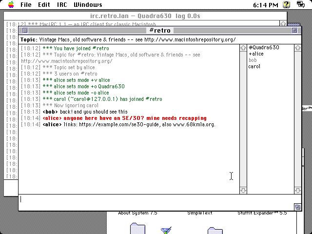
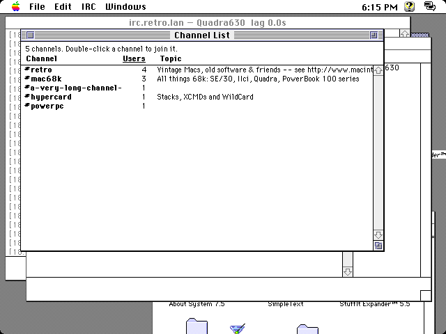
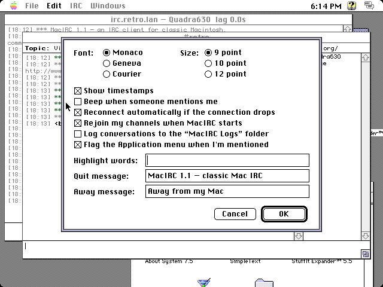

# MacIRC

**An IRC client for classic 68k Macintosh computers.**

MacIRC brings modern IRC chat to the Mac Plus, SE, Mac II, Classic, LC,
PowerBook and Quadra. It's written in C against the original Macintosh
Toolbox and MacTCP, so it looks and behaves like a native System 6 or
System 7 application. It runs in about 1 MB of memory.

[](https://github.com/acorncomputervideos-ux/MacIRC/actions/workflows/build.yml)
[](https://github.com/acorncomputervideos-ux/MacIRC/releases/latest)
[](https://github.com/acorncomputervideos-ux/MacIRC/releases)



*MacIRC 1.1 on a Quadra 630 (emulated) running System 7.5.5. The line in
red mentions one of the user's highlight words; the gray nick in the list
is away.*

## Download

Get the latest version from the
**[Releases page](https://github.com/acorncomputervideos-ux/MacIRC/releases/latest)**:

| File | Use it for |
|---|---|
| `MacIRC-1.1.dsk` | An 800K disk image. Open it in an emulator (Basilisk II, Mini vMac, SheepShaver, Snow) or write it to an 800K floppy. |
| `MacIRC-1.1.bin` | MacBinary, for copying to a real Mac over a network, serial cable or shared disk. Decode it with StuffIt Expander. |

## Requirements

- A 68k Mac with 128K ROM or later: Mac Plus, SE, SE/30, Mac II series,
  Classic, LC, PowerBook, Centris, Quadra and others. It also runs on Power
  Macs in emulation.
- System 6.0.4 or later. System 7.x is recommended.
- MacTCP, or Open Transport (which includes MacTCP compatibility).
- A network connection: Ethernet, or PPP/SLIP through a modem.
- About 1 MB of free memory (640 KB minimum).

> **No encryption.** MacIRC connects over plain-text TCP; a 68k Mac can't
> do modern TLS at a usable speed. Use a network that still accepts
> plain-text connections on port 6667, or run a bouncer (such as ZNC) or a
> TLS proxy on your local network and connect to that.

## Getting started

### 1. Set up TCP/IP

If your Mac is already online, skip this step.

1. Open the **MacTCP** control panel (or **TCP/IP** with Open Transport).
2. Select your network connection (usually **Ethernet**).
3. Click **More…**, then either choose **Dynamically**/**Server** if
   your network gives out addresses, or choose **Manually** and enter
   your gateway address.
4. Under **Domain Name Server Information**, enter `.` as the domain and
   your DNS server's address, and select **Default**.
5. If you chose Manually, enter the Mac's IP address in the main window.
6. Close the control panel and restart the Mac.

If MacIRC says *"TCP/IP has no IP address yet"*, this step hasn't been done.

### 2. Connect

1. Open **MacIRC** and choose **File ▸ Connect…** (⌘K).
2. Enter the server (for example `irc.libera.chat`), the port (usually
   6667), your nickname, and optionally:
   - **Channels** to join automatically, separated by spaces or commas
   - a **Password** if the server needs one (most don't)
   - your **NickServ** password, so MacIRC can identify you
3. Click **Connect**.

Once you're connected, type messages in the box at the bottom of a window
and press Return. Type `/join #channel` to join more channels, or
`/help` for the list of commands.

## Features

### Chatting

- **One window per conversation**: each channel and private conversation
  gets its own window, plus a server window for messages from the server.
- **Topic bar** at the top of each channel. Click it to change the topic.
- **Nick list** for each channel, with operators and voiced users first.
  It uses the server's own status prefixes (`~ & @ % +`) and keeps track of
  several at once. People who are away are shown in gray. Double-click a
  nick to start a private conversation.
- **Coloured conversations** on colour Macs: bold nicknames, gray
  timestamps, green joins and parts, purple actions, blue for your own
  messages.
- **Highlights**: lines that mention your nickname, or one of the words you
  list in Preferences, are shown in red and can play the alert sound.
- **Channel List** (IRC ▸ List Channels…): browse the server's channels,
  sort by name or size, and double-click one to join it.
- **Ignore list**: hide messages from nicknames or `nick!user@host` masks
  (`*` and `?` are wildcards).
- **Away**: IRC ▸ Set Away… marks you away with your saved message; choose
  **I'm Back** when you return.
- **Characters**: accented letters and typographic punctuation are
  converted between UTF-8 and the Mac's character set. Characters the Mac
  can't show, such as emoji, appear as `?`. mIRC colour and formatting
  codes are removed.



### Staying connected

- **Host names or IP addresses**, looked up with MacTCP's resolver.
- **Automatic reconnection** if the connection drops: MacIRC waits 10
  seconds, then 20, 40 and so on up to 5 minutes, then rejoins your
  channels. Choose File ▸ Disconnect to stop it.
- **Your channels come back** the next time you open MacIRC.
- **NickServ**: MacIRC identifies you after connecting.
- **Lag display**: the server window's title shows the delay to the server.
  If the server stops answering for 2 minutes, MacIRC reconnects.
- **Flood protection**: pasted text is sent at a pace servers accept, so
  you don't get disconnected. MacIRC asks before sending more than two
  pasted lines.

### Mac touches

- **Preferences** (Edit ▸ Preferences…): font (Monaco, Geneva or
  Courier), size (9, 10 or 12 point), timestamps, the alert sound,
  highlight words, quit and away messages, logging and reconnection.
- **Logs**: conversations can be saved as SimpleText files in a
  **MacIRC Logs** folder next to the application.
- **Links**: ⌘-click a web address to open it with Internet Config.
  Without Internet Config, the address is copied to the Clipboard.
- **Drag and drop** (System 7.5, or the Macintosh Drag and Drop
  extension): drag text out of a conversation, or drop text into the box
  you type in.
- **Windows menu**: switch with ⌘1–⌘9, or use **Tile Windows** and
  **Cascade Windows**. A bullet (•) marks windows with new messages and a
  diamond (◆) marks windows where someone mentioned you.
- **Zoom box** sizes the window to fit your screen, from a Classic's 9"
  screen to a large monitor.
- **Background alerts**: when someone mentions you while you're using
  another application, MacIRC flags the Application menu.
- **Balloon Help** for the menus.
- MacIRC keeps working in the background under MultiFinder and System 7,
  and the interface never freezes while it waits for the network.



## Keyboard

| Key | Action |
|---|---|
| Return or Enter | Send the message |
| Tab | Complete the nickname you've started typing |
| ↑ / ↓ | Recall earlier lines you typed |
| Page Up / Page Down | Scroll the conversation |
| Home / End | Jump to the top or bottom of the conversation |
| ⌘1 – ⌘9 | Switch to a window |
| ⌘K | Connect… |
| ⌘J | Join a channel |
| ⌘L | List channels |
| ⌘W | Close the window (and leave the channel) |

## Commands

| Command | What it does |
|---|---|
| `/join #channel [key]` | Join a channel |
| `/part [#channel] [reason]` | Leave a channel |
| `/msg nick text` | Send a private message |
| `/query nick [text]` | Open a private conversation |
| `/me action` | Describe an action (`* nick waves`) |
| `/notice target text` | Send a notice |
| `/nick newnick` | Change your nickname |
| `/topic [#channel] [text]` | Show or change the topic |
| `/names [#channel]` | List the people in a channel |
| `/whois nick` | Look someone up |
| `/away [message]` | Mark yourself away (`/away` alone switches it on or off) |
| `/back` | Mark yourself back |
| `/list [min users]` | Open the Channel List |
| `/ignore [mask]` | Ignore someone, or show the ignore list |
| `/unignore mask` | Stop ignoring someone |
| `/invite nick [#channel]` | Invite someone to a channel |
| `/kick nick [reason]` | Remove someone from the channel (operators only) |
| `/op`, `/deop`, `/voice`, `/devoice nick` | Change someone's channel status |
| `/ctcp nick command` | Send a CTCP request, such as `VERSION` |
| `/quote line` or `/raw line` | Send a raw IRC command |
| `/server host [port]` | Connect to a server |
| `/quit [message]` | Disconnect |
| `/clear` | Clear the window |
| `/close` | Leave the channel and close its window |
| `/help` | Show the commands |

Other commands, such as `/motd` or `/mode`, are sent to the server
unchanged. To send a message that starts with a slash, begin it with `//`.

## Troubleshooting

| Message | What to do |
|---|---|
| *TCP/IP has no IP address yet* | Set up the MacTCP or TCP/IP control panel and restart (see [Set up TCP/IP](#1-set-up-tcpip)). |
| *MacTCP is not available* | Install MacTCP or Open Transport. |
| *name server did not answer* / *host not found* | Check the name server address in MacTCP, or connect using the server's IP address. |
| *connection refused* / *timed out* | Check the server name and port. The server may only accept TLS connections. |
| *Nickname … is unavailable* | MacIRC tries adding `_`. Use `/nick` to pick another. |

## Privacy and security

- The server password and NickServ password are stored, unencrypted, in
  the **MacIRC Prefs** file (in the Preferences folder on System 7). Don't
  reuse an important password.
- Everything is sent without encryption, including passwords and private
  messages.

## Building from source

MacIRC is built with [Retro68](https://github.com/autc04/Retro68), a GCC
cross-compiler for classic Mac OS.

With Docker:

```sh
docker run --rm -v "$PWD":/src -w /src ghcr.io/autc04/retro68 sh -c '
  cmake -S . -B build \
    -DCMAKE_TOOLCHAIN_FILE=/Retro68-build/toolchain/m68k-apple-macos/cmake/retro68.toolchain.cmake &&
  cmake --build build'
```

With a local Retro68 toolchain:

```sh
cmake -S . -B build \
  -DCMAKE_TOOLCHAIN_FILE=/path/to/Retro68-build/toolchain/m68k-apple-macos/cmake/retro68.toolchain.cmake
cmake --build build
```

The build writes `MacIRC.dsk` (disk image), `MacIRC.bin` (MacBinary), and
`MacIRC.APPL`, `MacIRC.ad` and `%MacIRC.ad` (the application in raw,
AppleDouble and netatalk forms) to `build/`.

GitHub Actions builds every push. To publish a release, run the **Build**
workflow from the Actions tab and enter a version number, or push a tag
such as `v1.2`. Update `.github/release-notes.md` first, because it
becomes the release description.

### Source layout

| File | Purpose |
|---|---|
| `src/main.c` | Toolbox setup, event loop, menus, notifications |
| `src/window.c` | Conversation windows: topic bar, scrollback, input line, nick list, drag and drop |
| `src/irc.c` | IRC protocol, `/commands`, reconnection, flood control |
| `src/tcp.c` | Non-blocking TCP on the MacTCP `.IPP` driver |
| `src/dnr.c` | MacTCP name resolver glue |
| `src/mactcp.h` | MacTCP parameter block definitions |
| `src/chanlist.c` | Channel List window |
| `src/dialogs.c` | Connect and Preferences dialogs, prompts, alerts |
| `src/prefs.c` | Preferences file |
| `src/log.c` | Conversation logs |
| `src/url.c` | Finding links and opening them with Internet Config |
| `src/charset.c` | UTF-8 ⇄ Mac OS Roman, formatting-code removal |
| `src/util.c` | String helpers, wildcard matching, trap checks |
| `src/MacIRC.r` | Resources: menus, dialogs, alerts, icon, `SIZE` |
| `src/Balloons.r` | Balloon Help, generated by `tools/make_balloons.py` |

## Known issues

- Balloon Help works for the menus but doesn't appear in the Connect and
  Preferences dialogs.
- Tested on an emulated Quadra 630 with System 7.5.5 and MacTCP 2.0.6.
  Not yet tested on System 6, black-and-white Macs, Open Transport or real
  hardware. Reports from real machines are welcome; please
  [open an issue](https://github.com/acorncomputervideos-ux/MacIRC/issues).
